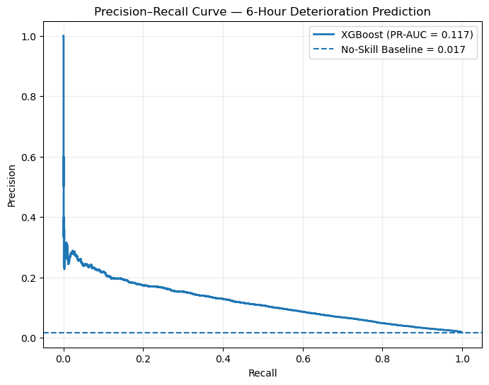
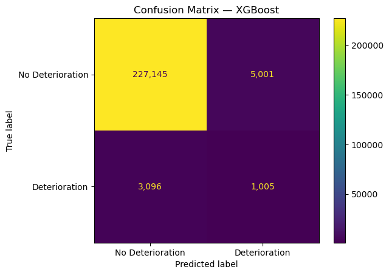
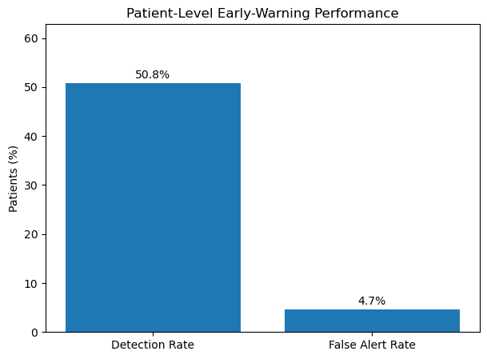

# Member Health Deterioration Risk Analysis

Microsoft Fabric project for predicting patient deterioration within the next six hours from ICU hourly observations. The workflow uses PhysioNet-style data, builds Bronze and Silver layers, evaluates an XGBoost classifier, and publishes controlled inference outputs to a Gold layer.

> This repository contains project code, aggregate results, and visualizations. It excludes raw clinical records, workspace identifiers, credentials, and patient-level result tables.

## Key results

| Metric | Reported result |
| --- | ---: |
| Test PR-AUC | 0.1166 |
| Random PR-AUC baseline | 0.0174 |
| Test ROC-AUC | 0.8414 |
| Chosen threshold | 0.5534 |
| Patient detection rate | 50.81% |
| Patient false-alert rate | 4.66% |

PR-AUC is emphasized because deterioration-positive hours are rare. The model ranks risk above random, but it is an analytical early-warning prototype and is not clinically validated.

## Visualizations

### Precision-recall curve

This shows the trade-off between identifying more positive hours and alert precision. Test PR-AUC is 0.1166 versus the 0.0174 random baseline.

### Confusion matrix

At the selected threshold, this chart reported 1,005 detected positive hours, 3,096 missed positive hours, and 5,001 false-positive alerts. Sensitivity improvement remains necessary.

### Patient-level early-warning performance

This asks whether a deteriorating patient received at least one alert. It reports 50.81% detection of deteriorating patients and a 4.66% false-alert rate among non-deteriorating patients.

## Project contents

- `notebooks/` — source preparation, Bronze ingestion, Silver transformations, ML evaluation, and Gold inference. Safe aggregate outputs and chart outputs are retained.
- `docs/images/` — project charts used in this README.
- `pipeline/` — logical notebook orchestration template.

## Important limitations

This is not clinical decision support. Real-world use needs clinical validation, governance approval, fairness and calibration analysis, prospective testing, drift monitoring, and a clinically selected operating threshold.

